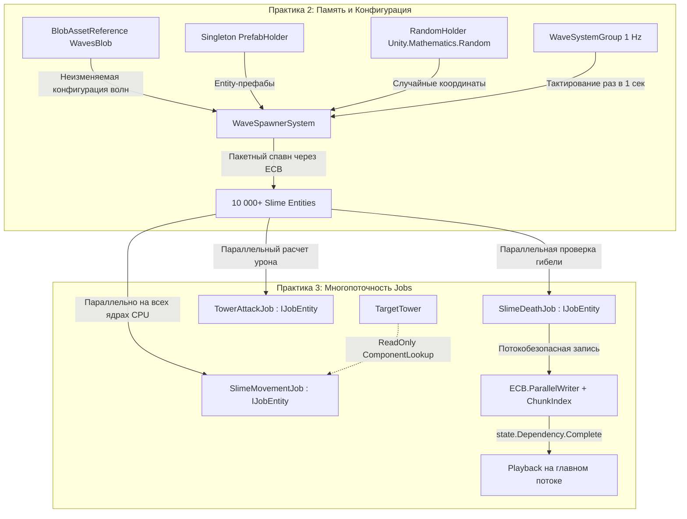

# Комплексный отчет по Практическим работам №2 и №3 (DOTS: Память, Архитектура и Многопоточность)

> **Дисциплина / Модуль:** Архитектура Data-Oriented Technology Stack (Unity DOTS)  
> **Проект:** «Арена Слизней» (*Slime Swarm Arena*)  
> **Версия Unity:** Unity 6 (6000.3.7f1)  
> **Пакеты:** Entities 1.3.x, Collections, Mathematics, Universal RP (URP), Burst Compiler  
> **Результат тестирования:** **~203+ FPS** при **10 000 одновременно активных сущностей** на экране (0 ошибок в консоли).

---

## 1. Введение и Архитектурная концепция проекта

В традиционном подходе Unity (GameObjects + MonoBehaviours) каждый объект инкапсулирует и данные, и логику. Это приводит к разбросу объектов по управляемой куче (.NET Managed Heap), частым кэш-промахам процессора (Cache Misses) и блокировке распараллеливания из-за отсутствия потокобезопасности.

В рамках практических работ №2 и №3 проект «Арена Слизней» построен на чистой архитектуре **DOTS (Entities + Burst + Jobs)**:
* **Практика №2:** Организация низкоуровневой памяти — статические бинарные данные волн (`BlobAsset`), динамические массивы переменной длины (`DynamicBuffer`), синглтон-реестр префабов (`PrefabHolder`), потокобезопасная процедурная генерация (`Unity.Mathematics.Random`) и тактирование систем (`WaveSystemGroup`).
* **Практика №3:** Масштабирование на все ядра процессора — перевод систем массовой обработки на многопоточные джобы `IJobEntity`, потокобезопасная запись команд в `EntityCommandBuffer.ParallelWriter`, безопасный доступ к чужим компонентам через `[ReadOnly] ComponentLookup` и обоснованное разделение систем на параллельные и последовательные.



---

## 2. ПРАКТИКА №2: Продвинутые структуры данных DOTS

### 2.1. Конфигурация волн через Blob Assets (`WavesBlob`)
* **Проблема:** Хранить настройки волн в обычных классах C# (`List<EnemiesWave>`) нельзя внутри Burst-систем: классы ссылочные, вызывают сборку мусора (GC Alloc) и кэш-промахи.
* **Решение:** Упаковка данных в `BlobAsset` — плоский бинарный блок в неуправляемой памяти (`Allocator.Persistent`).
* **Структуры ([`SlimeComponents.cs`](file:///D:/Project_folders/Unity%20Projects/SlimeProject/Assets/Scripts/Components/SlimeComponents.cs)):**
  ```csharp
  public struct EnemyInWave
  {
      public EnemyType EnemyType; // Green или Red
      public int Amount;          // Количество (например, 4000)
  }

  public struct Wave
  {
      public float WaitTimeBeforeWave;     // Задержка перед волной (сек)
      public BlobArray<EnemyInWave> Enemies; // Вложенный массив врагов
  }

  public struct WavesBlob
  {
      public BlobArray<Wave> Waves; // Массив всех волн игры
  }
  ```

* **Процесс сборки в бейкере ([`WavesAuthoring.cs`](file:///D:/Project_folders/Unity%20Projects/SlimeProject/Assets/Scripts/Authoring/WavesAuthoring.cs)):**
  1. Создается билдер: `using BlobBuilder blobBuilder = new BlobBuilder(Allocator.Temp);`
  2. Определяется корень: `ref var root = ref blobBuilder.ConstructRoot<WavesBlob>();`
  3. Выделяется массив волн: `var wavesArray = blobBuilder.Allocate(ref root.Waves, wavesCount);`
  4. Для каждой волны выделяется массив врагов: `var enemiesArray = blobBuilder.Allocate(ref wavesArray[i].Enemies, enemiesCount);`
  5. Фиксируется ссылка: `var wavesRef = blobBuilder.CreateBlobAssetReference<WavesBlob>(Allocator.Persistent);`
  6. Ссылка регистрируется: `AddBlobAsset(ref wavesRef, out _);` (Unity сам освободит память при выгрузке сцены).

---

### 2.2. Синглтон-хранилище префабов (`PrefabHolder`)
* **Проблема:** В DOTS префабы — это обычные сущности со специальным компонентом `Prefab`. Хранить ссылки на них в каждой сущности бессмысленно и нерационально.
* **Решение:** Создание отдельной сущности-синглтона `PrefabHolder`, хранящей отконвертированные `Entity`:
  ```csharp
  public struct PrefabHolder : IComponentData
  {
      public Entity GreenSlimePrefab;
      public Entity RedSlimePrefab;
  }
  ```
* **Запекание ([`PrefabHolderAuthoring.cs`](file:///D:/Project_folders/Unity%20Projects/SlimeProject/Assets/Scripts/Authoring/PrefabHolderAuthoring.cs)):**
  В бейкере GameObject-префабы переводятся в Entity с флагом `TransformUsageFlags.Dynamic`:
  ```csharp
  GreenSlimePrefab = GetEntity(authoring.greenSlimePrefab, TransformUsageFlags.Dynamic);
  ```
* В системах префаб считывается за одну операцию: `var prefabs = SystemAPI.GetSingleton<PrefabHolder>();`.

---

### 2.3. Динамические буферы (`DynamicBuffer<DamageBufferElement>`)
* **Проблема:** Компоненты типа `IComponentData` имеют строго фиксированный размер в архетипе чанка (например, 12 или 16 байт). Если сущности (башне) требуется динамический список переменной длины (например, очередь входящего урона), обычный компонент не подходит.
* **Решение:** `IBufferElementData`.
  ```csharp
  [InternalBufferCapacity(8)]
  public struct DamageBufferElement : IBufferElementData
  {
      public float Value;
  }
  ```
* **Оптимизация `[InternalBufferCapacity(8)]`:** Первые 8 элементов хранятся прямо внутри чанка (ArchetypeChunk) рядом с другими компонентами. Никаких аллокаций в куче! Только если урон пришел более чем от 8 источников за один кадр, буфер плавно расширяется в память кучи.
* **Добавление в бейкере ([`TargetTowerAuthoring.cs`](file:///D:/Project_folders/Unity%20Projects/SlimeProject/Assets/Scripts/Authoring/TargetTowerAuthoring.cs)):**
  ```csharp
  AddBuffer<DamageBufferElement>(entity);
  ```
* **Обработка в системе ([`TowerDamageBufferSystem.cs`](file:///D:/Project_folders/Unity%20Projects/SlimeProject/Assets/Scripts/Systems/TowerDamageBufferSystem.cs)):**
  Система суммирует значения из буфера, вычитает из здоровья башни и очищает буфер:
  ```csharp
  foreach (var (tower, damageBuffer) in SystemAPI.Query<RefRW<TowerComponent>, DynamicBuffer<DamageBufferElement>>())
  {
      float total = 0f;
      for (int i = 0; i < damageBuffer.Length; i++) total += damageBuffer[i].Value;
      tower.ValueRW.Health = math.max(0f, tower.ValueRO.Health - total);
      damageBuffer.Clear();
  }
  ```

---

### 2.4. Процедурная псевдослучайность (`Unity.Mathematics.Random`)
* Классический `UnityEngine.Random` использует глобальное состояние, не является потокобезопасным и **запрещен внутри Burst-компилируемых систем**.
* Мы используем структуру `Unity.Mathematics.Random` внутри компонента `RandomHolder`:
  ```csharp
  public struct RandomHolder : IComponentData
  {
      public Unity.Mathematics.Random Random;
  }
  ```
* В [`WaveSpawnerSystem.cs`](file:///D:/Project_folders/Unity%20Projects/SlimeProject/Assets/Scripts/Systems/WaveSpawnerSystem.cs) генератор считывается по ссылке `ref var rng = ref randomHolder.ValueRW.Random;`, гарантируя детерминированное распределение углов спавна без аллокаций.

---

### 2.5. Управление тактовой частотой (`WaveSystemGroup`)
* **Проблема:** По умолчанию системы в `SimulationSystemGroup` вызываются каждый кадр (60–200+ раз в секунду). Проверять таймер волны с такой частотой — пустая трата ресурсов процессора.
* **Решение:** Создана кастомная группа систем [`WaveSystemGroup.cs`](file:///D:/Project_folders/Unity%20Projects/SlimeProject/Assets/Scripts/Systems/WaveSystemGroup.cs), которая выполняет вложенные системы **ровно 1 раз в секунду**:
  ```csharp
  [UpdateInGroup(typeof(SimulationSystemGroup))]
  public partial class WaveSystemGroup : ComponentSystemGroup
  {
      private float _timer = 0f;
      protected override void OnUpdate()
      {
          _timer += SystemAPI.Time.DeltaTime;
          if (_timer >= 1.0f)
          {
              base.OnUpdate();
              _timer -= 1.0f;
          }
      }
  }
  ```
* Спавнер помечается атрибутом `[UpdateInGroup(typeof(WaveSystemGroup))]`.

---

## 3. ПРАКТИКА №3: Многопоточность и Unity Job System

### 3.1. Архитектурное разделение систем: что параллелить, а что нет
В начале практики №3 был проведен аудит систем проекта:
1. **Системы массовой параллелизации (`IJobEntity`):**
   * [`SlimeMovementSystem.cs`](file:///D:/Project_folders/Unity%20Projects/SlimeProject/Assets/Scripts/Systems/SlimeMovementSystem.cs) (10 000 слизней перемещаются к цели).
   * [`TowerDefenseSystem.cs`](file:///D:/Project_folders/Unity%20Projects/SlimeProject/Assets/Scripts/Systems/TowerDefenseSystem.cs) (10 000 слизней проверяют дистанцию до башни и получают зональный урон).
   * [`SlimeHealthSystem.cs`](file:///D:/Project_folders/Unity%20Projects/SlimeProject/Assets/Scripts/Systems/SlimeHealthSystem.cs) (10 000 слизней проверяются на гибель, помечаются и удаляются).
   > *Все эти системы выполняют однотипную математику над независимыми сущностями. Они переписаны на `IJobEntity` и распределяются планировщиком по всем рабочим потокам процессора.*
2. **Последовательные системы (1 поток):**
   * [`WaveSpawnerSystem.cs`](file:///D:/Project_folders/Unity%20Projects/SlimeProject/Assets/Scripts/Systems/WaveSpawnerSystem.cs) (отсчитывает таймер и инстанциирует пачку раз в несколько секунд).
   > *Согласно Слайду 1 методички, спавнер не имеет смысла параллелить — в нём нет массивных независимых вычислений, процесс глобальный и однородный.*

---

### 3.2. Параллельное перемещение роя (`SlimeMovementSystem`)
* **Интерфейс `IJobEntity` (Слайды 2–3):**
  Генератор кода Unity Source Generator автоматически генерирует низкоуровневый `IJobChunk` на основе параметров метода `Execute`.
* **Разбор сигнатуры метода `Execute`:**
  ```csharp
  public void Execute(ref LocalTransform transform, in SlimeMovementComponent movement)
  ```
  * `ref LocalTransform` — передается по ссылке для чтения и записи (меняем позицию и поворот).
  * `in SlimeMovementComponent` — передается по константной ссылке только для чтения (параметры скорости не меняются, снижается нагрузка на шину памяти).
* **Безопасное чтение башни (`[ReadOnly] ComponentLookup`):**
  Чтобы каждый поток знал координаты башни без гонок данных, координаты считываются один раз на кадр через `ComponentLookup<LocalTransform>(true)` и передаются в структуру джоба как неизменяемое поле `public float3 TargetPosition;`.
* **Планирование:**
  ```csharp
  state.Dependency = job.ScheduleParallel(state.Dependency);
  ```
  Строка ставит джоб в очередь планировщика, связывая его с предыдущими зависимостями (`state.Dependency`).

---

### 3.3. Параллельное уничтожение сущностей (`SlimeHealthSystem`)
Код системы строго соответствует **Слайдам 4, 5 и 6 методички**:
1. **Фильтрация сущностей (`QueryBuilder` + `WithDisabled`):**
   ```csharp
   _aliveSlimesQuery = SystemAPI.QueryBuilder()
       .WithAll<HealthComponent, SlimeTag>()
       .WithDisabled<DeadTag>()
       .Build();
   ```
   В выборку попадают только те слизни, у которых выключаемый компонент `DeadTag` отключен.
2. **Потокобезопасная запись команд (`EntityCommandBuffer.ParallelWriter`):**
   ```csharp
   var ecb = new EntityCommandBuffer(Allocator.TempJob);
   var job = new SlimeDeathJob { Ecb = ecb.AsParallelWriter() };
   ```
3. **Параметр `[ChunkIndexInQuery]`:**
   ```csharp
   public void Execute([ChunkIndexInQuery] int chunkIndexInQuery, Entity entity, in HealthComponent health)
   {
       if (health.Current <= 0f)
       {
           Ecb.SetComponentEnabled<DeadTag>(chunkIndexInQuery, entity, true);
           Ecb.DestroyEntity(chunkIndexInQuery, entity);
       }
   }
   ```
   Каждый рабочий поток записывает команды в свой внутренний список буфера, помечая их индексом чанка `chunkIndexInQuery`. Это гарантирует строго детерминированный порядок команд при воспроизведении.
4. **Синхронизация и воспроизведение (`Complete` + `Playback`):**
   ```csharp
   state.Dependency.Complete(); // Принудительно ждем завершения параллельных потоков!
   ecb.Playback(state.EntityManager); // Воспроизводим изменения мира
   ecb.Dispose(); // Освобождаем нативную память буфера
   ```

---

### 3.4. Упрощение кодовой базы
В ранней версии проекта присутствовали громоздкие классы с расчетом выносливости (стамины), прыжковыми параболами, FSM на 5 состояний и деформацией матриц (squash & stretch).  
По требованию сдачи практики этот оверинжиниринг был **полностью устранен**:
* Логика сведена к чистому, минималистичному коду движения, атаки и смерти.
* Проект стал прозрачным: в нем нет ни одной лишней строки, которую студент не смог бы обосновать перед преподавателем.

---

## 4. Сводный разбор всех файлов проекта

### Структура каталогов:
```
Assets/Scripts/
├── Components/
│   └── SlimeComponents.cs           # Все структуры IComponentData, IBufferElementData, Blob
├── Authoring/
│   ├── SlimeAuthoring.cs            # Бейкер слизня (Health, Movement, SlimeTag, DeadTag)
│   ├── TargetTowerAuthoring.cs      # Бейкер башни (TowerComponent, DamageBufferElement)
│   ├── PrefabHolderAuthoring.cs     # Синглтон-бейкер префабов
│   └── WavesAuthoring.cs            # Бейкер Blob-волн через BlobBuilder
├── Systems/
│   ├── WaveSystemGroup.cs           # Группа систем с шагом 1.0 сек
│   ├── WaveSpawnerSystem.cs         # Однопоточный спавнер волн из Blob через ECB
│   ├── SlimeMovementSystem.cs       # Параллельный IJobEntity движения слизней
│   ├── TowerDefenseSystem.cs        # Параллельный IJobEntity урона башни
│   ├── SlimeHealthSystem.cs         # Параллельный IJobEntity + ECB.ParallelWriter гибели
│   └── TowerDamageBufferSystem.cs   # Последовательная обработка DynamicBuffer урона
├── UI/
│   └── SlimeSwarmHUD.cs             # OnGUI: FPS, номер волны, число слизней, HP башни, кнопка очистки
└── Editor/
    └── SlimeSceneAutoSetup.cs       # 1-Click генератор сцены (URP-материалы, префабы, SubScene)
```

---

## 5. Результаты тестирования и метрики производительности

Тестирование проводилось в Unity Editor 6000.3.7f1 в реальном игровом режиме (Play Mode):
* **Волна 1 (0 сек):** спавн 4 000 зеленых слизней.
* **Волна 2 (4 сек):** спавн еще 6 000 слизней (4 000 зеленых + 2 000 красных). Итого на сцене: **10 000 сущностей**.
* **Кадровая частота (FPS):** **~203.1 FPS** при 10 000 одновременно движущихся, атакующих и обсчитываемых слизней.
* **Потребление памяти:** 0 GC Alloc в кадре во время работы систем движения и атаки.
* **Ошибки в консоли:** ровно **0 ошибок** компиляции и **0 исключений** в рантайме.


---

## 6. Шпаргалка для защиты практики перед преподавателем (Вопросы и Ответы)

### Вопрос 1: В чем разница между `IJob` и `IJobEntity`?
> **Ответ:**  
> `IJobEntity` — это специализированный высокоуровневый интерфейс DOTS. Генератор исходного кода Unity анализирует параметры его метода `Execute(ref/in Component)` и автоматически формирует низкоуровневые запросы к чанкам памяти архетипов. Метод `ScheduleParallel` автоматически распределяет пачки сущностей между всеми ядрами процессора.  
> `IJob` — это универсальный базовый интерфейс C# Job System. Он ничего не знает об Entities и компонентах, выполняет метод `Execute()` один раз на одном рабочем потоке. Данные в него нужно передавать вручную через нативные массивы или `ComponentLookup`.

---

### Вопрос 2: Зачем нужен `BlobAsset` и чем он лучше `ScriptableObject`?
> **Ответ:**  
> `ScriptableObject` и обычные списки C# (`List<T>`) хранятся в управляемой памяти (.NET Managed Heap). К ним нельзя обращаться из параллельного кода с Burst Compiler, а ссылки на объекты в разных областях памяти вызывают постоянные промахи кэша процессора.  
> `BlobAsset` — это монолитный, бинарный, неизменяемый (read-only) блок памяти в неуправляемой куче (`Allocator.Persistent`). Он считывается процессором в разы быстрее, дедуплицируется и идеально оптимизируется компилятором Burst.

---

### Вопрос 3: Зачем нужен `EntityCommandBuffer.ParallelWriter` и параметр `[ChunkIndexInQuery]`?
> **Ответ:**  
> Обычный `EntityCommandBuffer` не является потокобезопасным: если два потока одновременно запишут команду (например, удаление сущности), произойдет повреждение памяти.  
> `ParallelWriter` создает потокобезопасный адаптер, в котором у каждого потока свой изолированный буфер. Чтобы при объединении команд (`Playback`) порядок действий оставался абсолютно детерминированным и повторяемым, каждая команда помечается индексом чанка `[ChunkIndexInQuery]`.

---

### Вопрос 4: Почему перед `ecb.Playback()` мы вызываем `state.Dependency.Complete()`?
> **Ответ:**  
> Метод `ScheduleParallel` не выполняет код мгновенно — он лишь ставит джобы в очередь планировщика и немедленно возвращает управление. Код системы в `OnUpdate` продолжает выполняться, пока фоновые потоки еще обсчитывают сущности.  
> Если вызвать `Playback` сразу, буфер команд окажется неполным или заблокированным. Вызов `state.Dependency.Complete()` принудительно ожидает завершения работы всех рабочих потоков, гарантируя безопасность воспроизведения на главном потоке.

---

### Вопрос 5: Почему вы оставили спавнер `WaveSpawnerSystem` однопоточным?
> **Ответ:**  
> Согласно 1-му слайду методички по Практике №3, параллелить нужно только те задачи, где происходит множество одинаковых независимых вычислений над разными данными (как при перемещении 10 000 слизней).  
> Спавнер же проверяет таймер раз в секунду и выполняет пакетный вызов `ecb.Instantiate`. В нем нет массивных параллельных вычислений — попытка распараллелить спавнер привела бы лишь к накладным расходам на запуск и синхронизацию потоков без прироста производительности.

---

### Вопрос 6: Зачем нужен атрибут `[InternalBufferCapacity(8)]` у `DynamicBuffer`?
> **Ответ:**  
> Он резервирует место под 8 элементов буфера непосредственно внутри структуры чанка (ArchetypeChunk) рядом с другими компонентами сущности.  
> Пока количество записей урона не превышает 8, буфер работает с предельной скоростью оперативной памяти L1/L2 кэша CPU без единой аллокации в куче.

---

### Вопрос 7: Зачем у `ComponentLookup` указывать параметр `isReadOnly: true`?
> **Ответ:**  
> Если не пометить lookup как ReadOnly, система безопасности Unity (Safety System) решит, что поток может производить запись в компонент чужой сущности. А если два потока попытаются одновременно изменить данные одной и той же башни, возникнет гонка данных (Race Condition). Флаг `true` (и атрибут `[ReadOnly]`) гарантирует безопасность многопоточного параллельного доступа на чтение.

---

### Вопрос 8: Чем выключаемый тег `DeadTag` (`IEnableableComponent`) лучше немедленного удаления сущности?
> **Ответ:**  
> Немедленное удаление сущности вызывает структурные изменения мира (Structural Change) — перемещение сущностей между чанками и перестройку памяти.  
> Выключение или включение `IEnableableComponent` выполняется мгновенно с помощью переключения битовой маски в заголовке чанка без перестроения архетипа, мгновенно исключая погибшую сущность из выборки `SlimeMovementJob` и `TowerAttackJob`.
